  

  
  
  

  

## Featured Projects

  

## About Me

I'm a Python and web developer with an interest in cybersecurity, automation, and AI-based systems. I build practical applications and explore secure software development.

## Tech Stack

**Languages:** Python, JavaScript, SQL, HTML, CSS  
**Frameworks & Tools:** Flask, Git, GitHub, Linux, REST APIs  
**AI & Machine Learning:** TensorFlow, OpenCV, NumPy, Scikit-learn  
**Cybersecurity:** Secure coding, vulnerability assessment, and system hardening

## Certifications

- Google Cybersecurity Professional Certificate
- Automate Cybersecurity Tasks with Python
- Google Prompting Essentials
- Python Web Development Certification

## Education

Bachelor's Degree in Information Technology (2024–2028)  
Shaheed Benazir Bhutto University

## Connect

- Portfolio: https://litegenix.online
- LinkedIn: https://linkedin.com/in/litegenix
- Email: qadirshar66@gmail.com

⭐ Open to collaboration, internships, and freelance projects.
