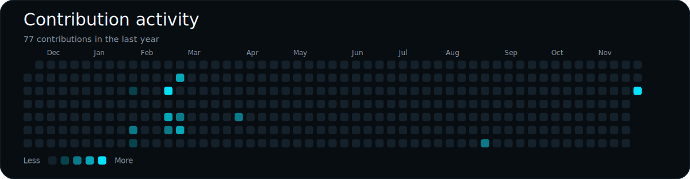
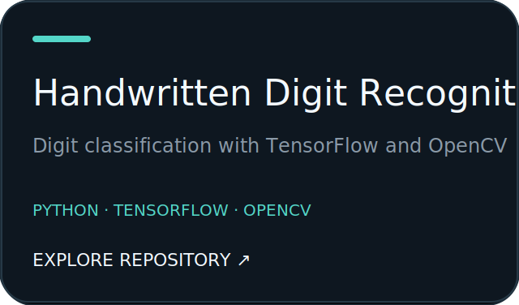
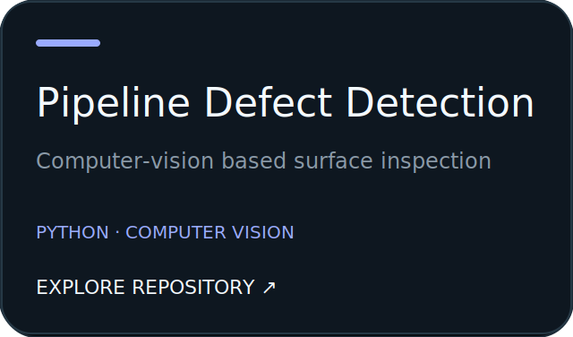

<h2 align="left">What I’m building</h2>

  <a href="https://github.com/litegenix">GitHub</a> ·
  <a href="https://qadirbux.tech">Portfolio</a> ·
  <a href="https://linkedin.com/in/litegenix">LinkedIn</a> ·
  <a href="mailto:owner@qadirbux.tech">Email</a>

<!-- Profile cards are generated from GitHub contribution data by .github/workflows/profile-cards.yml. -->
