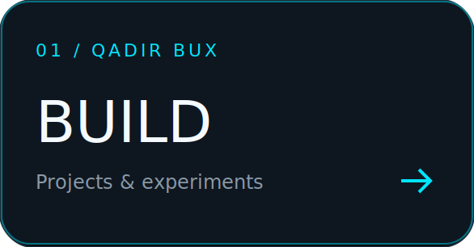
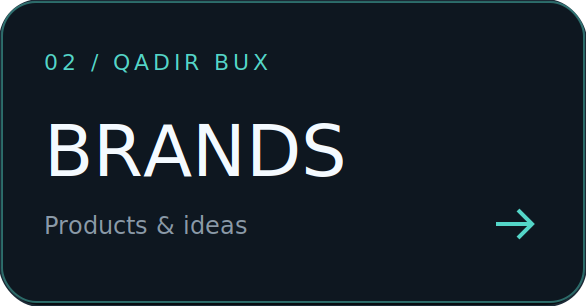
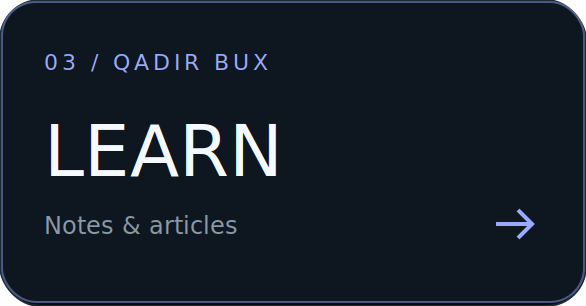
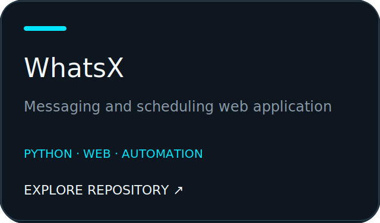

<!-- Profile layout inspired by the Three Worlds card arrangement. Cards are generated daily. -->

 
 
 
 
 

&nbsp;&nbsp;&nbsp;
&nbsp;&nbsp;&nbsp;
&nbsp;&nbsp;&nbsp;

<!-- The workflow refreshes contribution data and generated cards automatically. -->
